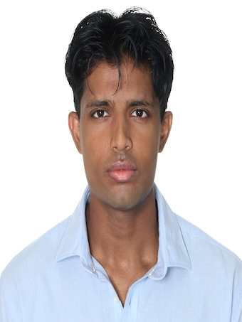
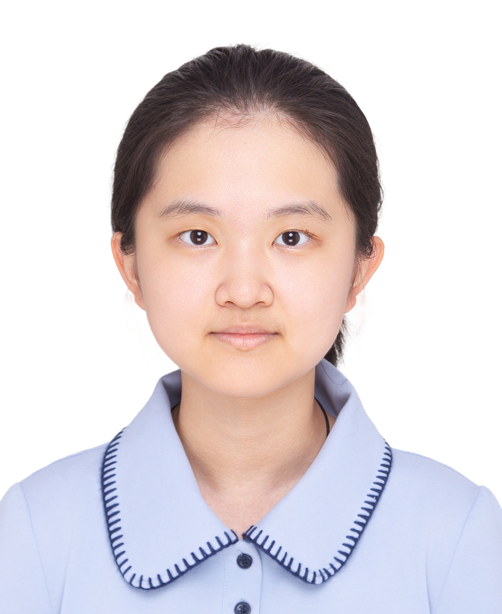
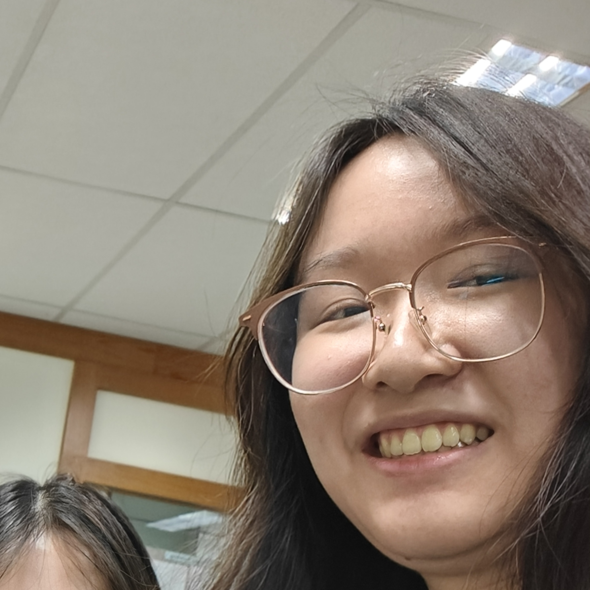
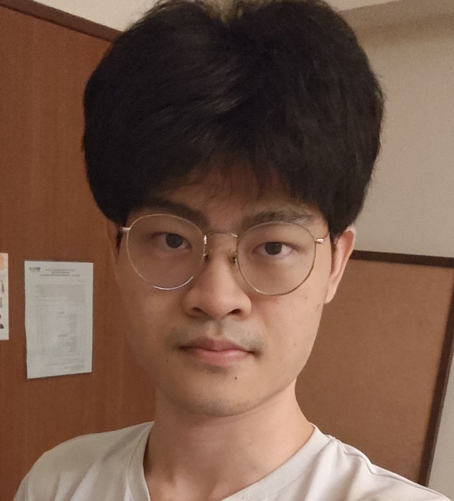

# About Us

We are a team based in the [School of Computing, National University of Singapore](http://www.comp.nus.edu.sg).

You can reach us through our [issue tracker](https://github.com/AY2627S1-CS2103T-T14-2/tp/issues).

## Project team

### Aahil

[[github](https://github.com/aahilma)]

- Role: Developer
- Responsibilities: Finding supporters (`find`, `list`, `quiet`), deleting supporters, phone number formats and the startup warning for unreadable data

### Yuning

[[github](https://github.com/jiangyuning07)]

- Role: Team Lead
- Responsibilities: Interaction history (`log`, `editlog`, `unlog`)

### Ke Ying

[[github](https://github.com/Oofky)]

- Role: Developer
- Responsibilities: Supporter detail panel (`view`), last-contact dates and name rules

### Aayan

[[github](https://github.com/aayanvatsa04)]

- Role: Developer
- Responsibilities: Contact fields (`add`, `edit`), introductions (`intro`), tags (`tag`, `untag`) and stage counts (`stats`)

### Young Yi Heng

[[github](https://github.com/yyihengg)]

- Role: Developer
- Responsibilities: Cultivation stages (`stage`), undo and redo, and command history
