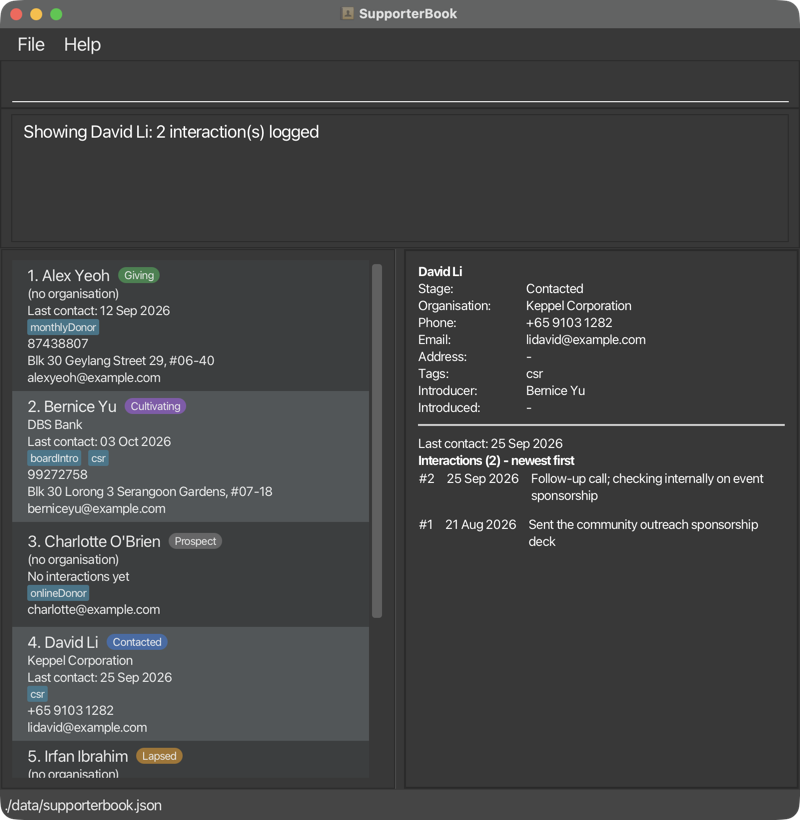

# SupporterBook User Guide

SupporterBook is a **desktop application for fundraising and outreach staff at small charities to manage donor and corporate supporter relationships, optimized for use through a Command Line Interface (CLI)** while retaining the benefits of a Graphical User Interface (GUI). It keeps supporter details, cultivation stages and interaction histories in one place. If you type quickly, SupporterBook can help you find and update supporter records faster than traditional GUI applications.

<!-- * Table of Contents -->
<page-nav-print />

---

## Quick start

1. Ensure that Java `25` or later is installed on your computer.<br>
   **Mac users:** Ensure you have the precise JDK version prescribed [here](https://se-education.org/guides/tutorials/javaInstallationMac.html).

1. Download the latest `supporterbook.jar` file from [here](https://github.com/AY2627S1-CS2103T-T14-2/tp/releases).

1. Copy the file to the folder you want to use as the _home folder_ for SupporterBook. Your data is saved in a `data` folder inside it.

1. Open a terminal, `cd` to the folder containing the JAR file, and run `java -jar supporterbook.jar`.<br>
   A GUI similar to the one below should appear in a few seconds. Note how the app contains some sample supporters. A few already have logged interactions, which you can see with `view`.<br>
   

1. Type a command in the command box and press Enter to execute it. For example, type **`help`** and press Enter to open the help window.<br>
   Some example commands you can try:
   - `list` : Lists all supporters.

   - `add n/Tan Wei Ming p/91234567 e/weiming@dbs.com o/DBS Bank` : Adds a supporter named `Tan Wei Ming` from `DBS Bank`.

   - `log 1 nt/Called about the year-end appeal` : Logs an interaction with the 1st supporter shown in the current list.

   - `view 1` : Shows the 1st supporter's interaction history.

   - `stage 1 contacted` : Sets the 1st supporter's cultivation stage to `Contacted`.

   - `delete 3` : Deletes the 3rd supporter shown in the current list, together with their interactions.

   - `exit` : Exits the app.

1. Refer to the [Features](#features) section below for details of each command.

---

## Features

<box type="info" seamless>

**Notes about the command format:**<br>

- Words in `UPPER_CASE` are the parameters to be supplied by the user.<br>
  For example, in `add n/NAME`, replace `NAME` with a value such as `John Doe`.

- Supporter indices must be positive integers. For example, `delete 0`, `delete abc`, `view 0` and `edit 0 n/x` report `Index must be a positive integer (1, 2, 3, ...).` followed by the command's usage.<br>
  For `editlog` and `unlog`, missing, extra or invalid indices report `Provide exactly two positive integer indices: INDEX ENTRY.` followed by usage. A positive index that does not identify a displayed supporter or interaction is rejected separately during execution. For commands requiring a single supporter index, a missing index or extra words in the index argument produce `Invalid command format!` followed by usage. Missing required fields can also produce this format error.

- Items in square brackets are optional.<br>
  For example, `n/NAME [t/TAG]` can be used as `n/John Doe t/friend` or as `n/John Doe`.

- Items followed by `...` can appear zero or more times.<br>
  For example, `[t/TAG]... ` may be omitted, or written as `t/friend` or `t/friend t/family`.

- Parameters can be in any order.<br>
  For example, if the command specifies `n/NAME p/PHONE`, `p/PHONE n/NAME` is also acceptable.
  For `find`, name keywords must come before the first prefix; its prefixed filters can be in any order.

- A command only recognises the prefixes in its own format. Other prefix-like words normally stay part of the value before them, e.g. `em/` mistyped for `e/`, or `e/` used in `log`. The exception is `find`: known prefixes outside its search format are rejected with an unsupported-search-filter error. Other prefix-like words are not automatically rejected, since addresses and notes can contain slashes, e.g. `Unit/3`.<br>
  For words treated as ordinary text, SupporterBook adds an advisory note in the cases below. This includes prefixes that belong to another command, e.g. `by/` in `add`, `st/` in `edit` or `t/` in `log`:
  - If the command saves the word, e.g. into an address or a note, the note follows the result, so you can run `undo` and enter the command again. For example, `log 1 nt/Called dte/2024-10-01` logs the note `Called dte/2024-10-01` dated today, and points out `dte/`.
  - If the command's format or one of its values is invalid, the note follows the error, as the mistyped prefix may be what made the value before it invalid. For example, `add n/Tan p/91234567 by/1` shows the rules for phone numbers, followed by `Note: by/ is not a recognised prefix for this command, so it was read as part of the value before it.`
  - If the format and values are valid but the command still cannot be carried out, only the error is shown. For example, `log 999 nt/Called dte/2024-10-01` with fewer than 999 supporters displayed reports the invalid index without a note.

  Everyday words such as `s/o`, `c/o`, `w/` and `and/or` are not flagged. If a note points out a word you meant to type, such as `Unit/` in an address, you can ignore it.

- Extraneous parameters for commands that take no parameters, such as `help`, `list`, `stats`, `exit`, `clear`, `undo` and `redo`, are ignored.<br>
  For example, `help 123` is interpreted as `help`. Prefix-like words in these ignored parameters do not produce a note.

- If you are using a PDF version of this document, be careful when copying and pasting commands that span multiple lines as space characters surrounding line-breaks may be omitted when copied over to the application.
  </box>

### Viewing help: `help`

Shows a message explaining how to access the help page.


Format: `help`

### Adding a supporter: `add`

Adds a supporter to SupporterBook.

Format: `add n/NAME [p/PHONE] [e/EMAIL] [a/ADDRESS] [o/ORGANISATION] [st/STAGE] [t/TAG]... `

- At least one of `p/PHONE` and `e/EMAIL` must be given, so that there is a way to reach the supporter. Online donors often give only an email, and people met at events often give only a number.
- `a/ADDRESS` can be left out, e.g. when you do not know a corporate contact's postal address.
- To leave out a field the supporter does not have, leave out its prefix too. A prefix with nothing after it, e.g. `e/` on its own, is rejected with a message saying which field is blank. (In `edit`, an empty prefix clears the field instead.)
- `ORGANISATION` is the company or group the supporter belongs to, e.g. the company a CSR contact speaks for. Leave out `o/ORGANISATION` for individual donors.
- `ORGANISATION` can contain any characters (e.g. `Procter & Gamble`), with the exception of a space followed by a recognised command prefix such as `a/` or `t/` (e.g. `Bang & Olufsen a/s`, where `a/s` is interpreted as another field). It must not be blank, and can be at most 100 characters long after leading and trailing spaces are removed and repeated internal spaces are reduced to one. For this limit, simple emoji such as 😀 count as one character, while combined emoji or a letter with a combining accent can count as more than one.
- `EMAIL` must be of the form `local-part@domain`. The local part can contain letters, digits and the special characters `+`, `_`, `-` and `.`, e.g. `wei_ming+donations@dbs.com`. A period cannot start or end the local part, or appear twice in a row. The domain is made up of labels separated by periods, e.g. `u.nus.edu`.
- `STAGE` is the supporter's cultivation stage, and must be one of `prospect`, `contacted`, `cultivating`, `giving`, `lapsed` or `declined`. Upper and lower case are both accepted.
- If `st/STAGE` is left out, the new supporter starts at stage `Prospect`.
- `PHONE` may start with `+` and must contain between 3 and 15 main-number digits.
  Digit groups may be separated by single spaces or hyphens, including a mixture of both.
  A digit group may be enclosed in balanced parentheses, e.g. `(65) 9123 4567`.
  Consecutive separators such as `+65  9123` or `+65- 9123` are not accepted.
- A phone number may end with `ext` followed by 1 to 6 extension digits and/or an alphabetic
  label in parentheses, with single spaces between parts. `ext` is case-insensitive.
  If both are supplied, the extension comes before the label, e.g. `9123 4567 ext 12 (Office)`.
  Labels contain English letters, optionally separated by single spaces, e.g. `(HP)`, `(Home)`
  and `(Office Fax)`. Extension digits do not count towards the main number's 3-to-15-digit limit.
  Your formatting, including the extension and label, is preserved when displayed and saved.
- `NAME` must start with a letter or digit, and can contain letters, digits, spaces, apostrophes (`'`), hyphens (`-`), periods (`.`), commas (`,`), round brackets (`(` and `)`) and at signs (`@`), e.g. `O'Brien`, `Lee-Tan`, `J. Tan`, `Tan, Ah Kow`, `Tan Ah Kow (Chen Ah Kow)` and `Ahmad bin Ali @ Ah Mat`.
- `NAME` can also contain `s/o` or `d/o` as separate words, e.g. `Ravi s/o Kumar` and `Priya d/o Kumar`. Upper and lower case are both accepted.
- SupporterBook only checks which characters a name uses, not whether it looks like a real name. For example, `s/o Kumar` or a name with only initials is accepted.
- Round brackets in `NAME` do not need to be balanced, and spaces around punctuation are optional. The name must still start with a letter or digit, so `(Tan)` and `@Tan` are rejected. These name rules apply to both `add` and `edit`.
- Extra spaces in `NAME` are removed, e.g. `n/  Tan   Wei Ming` is saved as `Tan Wei Ming`.
- Two supporters cannot have the same name. Names are compared ignoring capital letters and extra spaces, so `tan wei ming` is the same supporter as `Tan Wei Ming`. If two different people share a name, add something to tell them apart, e.g. `n/Tan Wei Ming DBS`.
- `TAG` must be alphanumeric, with no spaces, e.g. `t/boardIntro`. Tags that differ only in capitalisation, e.g. `t/vip t/VIP`, count as one tag, and the spelling typed first is kept.
- After adding, the list shows all supporters in the order they were added (any `find` or `quiet` filter is cleared), with the new supporter at the bottom.

If another supporter has the same phone number or email, the addition still succeeds, but a
warning names the existing supporters and identifies the shared fields. Shared contact details
may be legitimate, so the warning does not block saving. Check the named records before deciding
whether to keep or undo the addition.

Phone comparison uses the complete number, ignoring formatting; country codes are not inferred,
so `+65 9123-4567` and `6591234567` match, but `91234567` is not assumed to be the same number.
Email comparison ignores case but does not remove dots or `+suffixes`.
The check includes supporters hidden by `find` or `quiet`. It applies when adding, not when editing
or loading existing data, and does not change the rule that duplicate names are rejected.

For example, if Alex Yeoh already has phone `87438807`, `add n/Dup Phone p/87438807` still adds
the new supporter and includes a warning identifying `Alex Yeoh (phone)`.

<box type="tip" seamless>

**Tip:** A supporter can have any number of tags, including zero, e.g. `t/boardIntro` for someone introduced by a board member.
</box>

Examples:

- `add n/Aisha Rahman e/aisha.r@gmail.com` adds an online donor who gave only an email.
- `add n/Marie Laurent p/+33 1 42 68 53 00` adds a supporter with an international phone number.
- `add n/Phone Label Test p/9123 4567 (HP)` stores a phone number with a type label.
- `add n/Phone Extension Test p/(65) 9123-4567 ext 12 (Office)` stores a country code, extension and label.
- `add n/J. O'Brien-Tan p/91234567` adds a supporter whose name contains periods, apostrophes and hyphens.
- `add n/Ahmad bin Ali @ Ah Mat e/a1@example.com` adds a supporter whose name contains an alias marked with `@`.
- `add n/Tan Ah Kow (Chen Ah Kow) e/a2@example.com` adds a supporter whose name contains a dialect name in round brackets.
- `add n/Tan, Ah Kow e/a3@example.com` adds a supporter whose name contains a comma.
- `add n/Ravi s/o Kumar p/81112222 a/Bedok North Ave 1 st/contacted` adds a supporter named `Ravi s/o Kumar` at stage `Contacted`.
- `add n/John Lim p/81112222 e/johnlim@example.com a/Bedok North Ave 1 st/lapsed` adds a past donor at stage `Lapsed`.
- `add n/Tan Wei Ming p/91234567 e/weiming@dbs.com a/12 Marina Boulevard o/DBS Bank t/boardIntro` adds a CSR contact at DBS Bank who was introduced by a board member.

### Listing all supporters: `list`

Shows all supporters in the order they were added, clearing any active `find` or `quiet` filter and its sorting.

Format: `list`

The success message is `Listed all supporters.`, even when the list is empty.
Anything typed after the command word is ignored; `list 123` behaves as `list`.

Each supporter card shows the last-contact date below the organisation, for example `Last contact: 03 Oct 2026`. If the supporter has no logged interactions, it shows `No interactions yet`. The last-contact date is the latest interaction date, even if an interaction with an earlier date was logged afterwards.

### Editing a supporter: `edit`

Edits an existing supporter's details, keeping their stage and interaction history.

Format: `edit INDEX [n/NAME] [p/PHONE] [e/EMAIL] [a/ADDRESS] [o/ORGANISATION] [t/TAG]... `

- Edits the supporter at the specified `INDEX`. The index refers to the index number shown in the displayed supporter list, including after `find`. The index **must be a positive integer** 1, 2, 3, ...
- At least one of the optional fields must be provided.
- Existing values will be updated to the input values. Each value follows the same rules as in `add`.
- When editing tags, all of the supporter's existing tags are removed; adding tags is not cumulative. To add or remove single tags and keep the rest, use `tag` and `untag` instead.
- To remove all of a supporter's tags, enter `t/` without a tag after it.
- To clear a supporter's address or organisation, enter `a/` or `o/` with nothing after it.
- To clear a supporter's phone number or email, enter `p/` or `e/` with nothing after it. This works only if the supporter keeps the other one, since every supporter needs a way to be reached. You can clear one and give a new value for the other in the same command, e.g. `edit 1 e/ p/91234567`.
- A supporter's name cannot be cleared.
- A supporter's stage cannot be changed with `edit`, and stays the same when other details are edited. Use the `stage` command instead.
- A supporter's logged interactions are kept when their details are edited.
- A supporter's introducer is kept when their details are edited. If you rename a supporter who introduced others, those supporters show the new name as their introducer.
- A supporter's name cannot be changed to the name of another supporter, using the same comparison as `add`. Changing only the capitalisation of their own name is allowed.
- If the edited record shares a phone number or email with another supporter, the edit still succeeds and a warning names the matching supporters and fields, using the same comparison rules as `add`. Hidden supporters are included, but the edited supporter is not compared with their own original record. The warning reflects the resulting record, including contact details you did not change; check whether the sharing is intentional before keeping or undoing the edit.
- After editing, the list shows all supporters in the order they were added (any `find` or `quiet` filter is cleared).

Examples:

- `edit 1 p/91234567 e/weiming@dbs.com` Edits the phone number and email address of the 1st supporter to be `91234567` and `weiming@dbs.com` respectively.
- `edit 1 p/+65-9123-4567` Changes the 1st supporter's phone number using an international country code.
- `edit 2 n/Tan Wei Ming DBS t/` Edits the name of the 2nd supporter to be `Tan Wei Ming DBS` and clears all existing tags.
- `edit 2 n/Priya d/o Kumar` Edits the name of the 2nd supporter to be `Priya d/o Kumar`.
- `edit 3 o/OCBC Bank` Changes the organisation of the 3rd supporter to `OCBC Bank`, e.g. after they change jobs.
- `edit 4 a/ o/` Clears the address and organisation of the 4th supporter, e.g. after they retire and move.
- `edit 5 p/` Clears the phone number of the 5th supporter, who keeps their email.

### Setting a supporter's stage: `stage`

Changes how far the relationship with a supporter has progressed.

Format: `stage INDEX STAGE`

- Sets the stage of the supporter at the specified `INDEX`. The index refers to the index number shown in the displayed supporter list. The index **must be a positive integer** 1, 2, 3, ...
- `STAGE` must be one of the six stages below. Upper and lower case are both accepted. No prefix is needed before it, but `st/STAGE`, as used by `add` and `find`, also works: `stage 1 st/giving` is the same as `stage 1 giving`.
- Any stage can be changed to any other stage, e.g. a lapsed donor can be moved back to `cultivating`.
- If the supporter is already at that stage, their record is unchanged and a message says so.
- On success, the detail panel switches to this supporter and shows their current stage, including when they are already at the requested stage.
- The current list filter remains active. Changing a supporter's stage can remove them from a `find` or `quiet` result if they no longer match. Check the displayed indices again after making a change.

| Stage         | Meaning                                                                            |
| ------------- | ---------------------------------------------------------------------------------- |
| `Prospect`    | Identified as a possible supporter, not yet approached. New supporters start here. |
| `Contacted`   | First approach made, with no real conversation yet.                                |
| `Cultivating` | In an active relationship or discussion, not yet giving.                           |
| `Giving`      | Currently donating (an individual) or partnering (a company).                      |
| `Lapsed`      | Gave before, but is no longer giving.                                              |
| `Declined`    | Said no.                                                                           |

Each supporter's stage is shown as a coloured badge next to their name in the list.

Examples:

- `stage 2 cultivating` moves the 2nd supporter in the displayed list to stage `Cultivating`.
- `find Tan` followed by `stage 1 GIVING` moves the 1st supporter in the results of the `find` command to stage `Giving`.

### Counting supporters by stage: `stats`

Shows how many supporters are at each cultivation stage, e.g. to check whether there are enough prospects early in the year.

Format: `stats`

- Every supporter is counted, including those hidden by a `find` filter.
- All six stages are listed in order on one line, including stages with no supporters.
- The displayed list and the detail panel do not change.
- Anything typed after the command word is ignored; `stats 123` behaves as `stats`.

For example, with four supporters:

```text
Supporters by stage (4 in total):
Prospect: 1, Contacted: 0, Cultivating: 0, Giving: 2, Lapsed: 1, Declined: 0
```

### Finding supporters by name or other fields: `find`

Finds supporters by name, organisation, tag, stage, phone number or email. Combine fields to narrow a search.

Format: `find [KEYWORD]... [o/ORG]... [t/TAG]... [st/STAGE]... [p/PHONE]... [e/EMAIL]...`

Supply at least one name keyword or nonempty prefix value. Name keywords are optional when a field filter is given.

| Search field | Input | Matching rule |
| --- | --- | --- |
| Name | `KEYWORD` | Case-insensitive substring; `wei` matches `Tan Wei Ming` and `Weiling Koh` |
| Organisation | `o/ORG` | Case-insensitive substring; `o/dbs` matches `DBS Bank` |
| Tag | `t/TAG` | Case-insensitive substring of any tag; `t/board` matches `boardIntro` |
| Stage | `st/STAGE` | Complete stage name, ignoring case; `st/GIVING` matches `Giving`, but `st/giv` is invalid |
| Phone | `p/PHONE` | Digit substring after ignoring formatting, a trailing type label and the `ext` marker; extension digits remain searchable |
| Email | `e/EMAIL` | Case-insensitive substring; `e/@gmail` matches an address containing `@gmail` |

- **OR within a field:** any name keyword can match, and repeated values of a prefix are alternatives. For example, `find st/giving st/lapsed` finds supporters at either stage.
- **AND between fields:** every specified field must match. For example, `find tan o/DBS st/giving` finds supporters whose names contain `tan`, whose organisation contains `DBS`, and whose stage is `Giving`.
- Repeating an identical value does not duplicate supporters or change the matches.
- Name keywords must appear before the first prefix, without quotation marks. Use `find tan o/DBS Bank`, not `find o/DBS Bank tan`: the latter searches for the organisation text `DBS Bank tan`.
- Prefixes used by other commands (`n/`, `a/`, `dt/`, `nt/` and `by/`) are rejected anywhere in a search. The error lists each unsupported prefix, states that `find` supports only `o/`, `t/`, `st/`, `p/` and `e/`, and includes the usage message. Use `find alex` to search by name; `find n/alex`, `find a/geylang` and `find o/dbs a/geylang` are rejected.
- Prefix values may contain multiple words. Each prefix value is one search phrase; `o/DBS Bank` searches for that phrase. Name keywords are separated by whitespace and use OR; `weiming` does not match `Wei Ming`.
- Prefixed filters can appear in any order. To provide alternatives, repeat the prefix: use `st/giving st/lapsed`, not `st/giving lapsed`.
- Phone queries follow the phone format above, but the main-number length limit does not apply.
  For example, `p/91-23` matches `91234567`, `p/(65) 9123` matches `(65) 9123-4567 (HP)`,
  and `p/4567 ext 12` matches `9123 4567 ext 12 (Office)`.
  Formatting, the `ext` marker and type labels are ignored; the main and extension digits form
  the searchable digit sequence. Queries must contain main-number digits: `p/+` and `p/(HP)`
  are rejected. Labels cannot be searched by themselves using `p/`.
- A supporter without an organisation, phone number, email or tags does not match a search on that missing field.
- Results stay in their original list order and are numbered from 1. Other commands use these displayed indices.
- A new `find` searches all supporters and replaces the previous filter. `list`, `add`, `edit`, `undo` and `redo` show the full list again.
- Searching preserves the viewed supporter, even when they are absent from the results. It does not change saved supporter data or add an undo point, and it preserves redo history.
- `find` without criteria and empty filters such as `o/` are rejected. Invalid stage names produce the stage error message. Invalid searches leave the previous results unchanged.

For a list containing `Tan Wei Ming`, `Tan Ah Kow` and `Weiling Koh`:

- `find wei` returns `Tan Wei Ming` and `Weiling Koh`.
- `find tan wei` returns all three supporters.
- `find KOH` returns `Weiling Koh`.
- `find tan tan` returns the same results as `find tan`.

Other examples:

- `find o/DBS Bank` finds supporters whose organisation contains `DBS Bank`.
- `find t/board t/donor` finds supporters with a tag containing either `board` or `donor`.
- `find st/giving st/lapsed e/@gmail` finds supporters at either stage whose email contains `@gmail`.
- `find tan lim o/DBS o/OCBC st/giving` means `(name contains tan OR lim) AND (organisation contains DBS OR OCBC) AND (stage is Giving)`.

The success message reports the number of matches, for example `3 supporter(s) listed!`.
If nothing matches, the list is empty and the message is `0 supporter(s) listed!`.
Run `list` to show all supporters again.

### Finding supporters who have gone quiet: `quiet`

Shows supporters needing follow-up, starting with those who have gone longest without contact.

Format: `quiet [DAYS]`

- `quiet` uses a threshold of 60 days. Supply a positive whole number to change it, e.g. `quiet 30`.
- Supporters with no interactions are included. Supporters at stage `Declined` are excluded, even if they have no interactions.
- A supporter with interactions is included only if their most recent interaction was **more than** `DAYS` calendar days ago. Someone contacted exactly 60 days ago is excluded from `quiet 60`; someone contacted 61 days ago is included.
- Last contact is the latest interaction date, regardless of logging order. Logging an older interaction does not replace a more recent last-contact date.
- Supporters with no interactions appear first, followed by the oldest last-contact date. Ties retain the order in which supporters appear in the full list.
- The date is taken from the computer's local clock when you run the command. Rerun `quiet` to refresh the threshold after the date changes.
- Each `quiet` searches all supporters and replaces the previous filter and ordering. It does not narrow a previous `find` result.
- Other commands use the numbers in this displayed list. For example, `quiet` followed by `view 1` opens the first quiet supporter, and `delete 1` deletes that supporter.
- Changes to interactions or stages refresh the quiet list. Logging recent contact can remove a supporter; deleting their last interaction can move them to the top. Check the displayed indices again after a change.
- `list` restores the full list in its normal order. `find` restores normal ordering for its matching results. Successful `add`, `edit`, `undo` and `redo` also restore the full list in normal order.
- Running `quiet` preserves the viewed supporter, supporter data and saved order. It adds no undo point and preserves redo history.
- Supply at most one day count, from `1` to `2147483647`. Zero, negatives, decimals, non-numbers, larger values and additional arguments are rejected without changing the current list or selection.

Examples:

- `quiet` lists eligible supporters with no interactions or last contact more than 60 days ago.
- `quiet 30` uses a shorter threshold for more frequent follow-up.
- `quiet 90` followed by `view 1` opens the first supporter in that result.
- `list` restores the normal list when you finish reviewing quiet supporters.

The success message reports the count and threshold, for example:

```text
3 supporter(s) listed: no interactions or last contacted more than 60 days ago.
```

No matches produces an empty list and the same message with a count of `0`.

### Deleting a supporter: `delete`

Permanently removes the specified supporter together with every interaction logged with them.

Format: `delete INDEX`

- Deletes the supporter at the specified `INDEX`, including their entire interaction history.
- The index refers to the index number shown in the displayed supporter list, including after `find`.
- The index **must be a positive integer** 1, 2, 3, ...
- The success message reports the number of interactions removed, including `0` when there were none. Identical entries are counted separately.
- The current find filter is retained, and supporters below the deleted entry move up one number.
- If the supporter is shown in the detail panel, their details and history are cleared and the startup prompt returns. Deleting another supporter preserves the panel's displayed supporter.
- Other supporters' details and interaction histories are unchanged, including notes that mention the deleted supporter.
- If the deleted supporter introduced others, they are removed as those supporters' introducer, and the success message says how many supporters this affected.

Examples:

- `list` followed by `delete 2` deletes the 2nd supporter in the full list.
- `find Tan` followed by `delete 1` deletes the 1st supporter in the search results and keeps the filter.

For a supporter with two interactions, the success message has two lines:

```text
Deleted supporter: Tan Wei Ming; Stage: Prospect; Phone: 91234567
2 logged interaction(s) were deleted with them.
```

Deletion has no confirmation prompt. If you delete the wrong supporter, run [`undo`](#undoing-a-change-undo) straight away to restore them with their interaction history. An invalid command or an index beyond the displayed list leaves supporter data, the list and the viewed selection unchanged.

### Logging an interaction: `log`

Records an interaction with a supporter, dated today or on a specified past date.

Format: `log INDEX nt/NOTE [dt/DATE]`

- Logs the interaction against the supporter at the specified `INDEX`. The index refers to the index number shown in the displayed supporter list and must be a positive integer.
- `NOTE` records what happened. It can contain any characters, must not be blank, and can be at most 500 characters long. Leading and trailing spaces are removed. For this limit, simple emoji such as 😀 count as one character, while combined emoji or a letter with a combining accent can count as more than one.
- Without `dt/`, the date defaults to today when the command runs, using the computer's clock.
- `DATE` must be a valid date in `yyyy-MM-dd` format, e.g. `2024-02-29`, from `1900-01-01` through today (inclusive). Empty or out-of-range dates are rejected. Today is determined by the computer's clock.
- `nt/` and `dt/` can appear in either order. Each prefix may only be supplied once.
- Each supporter's oldest interaction is `#1`; the newest has the largest number. On equal dates, the later-logged entry has the larger number and appears first.
- Back-dating can renumber existing entries; entry numbers are not permanent IDs.
- Identical notes logged on the same day are accepted as separate interactions.
- The success message shows the supporter, date, note and entry number matching the panel.
- The panel switches to this supporter and displays entries newest first.
- Logging an interaction does not change the supporter's cultivation stage or clear the active list filter. A `find` result remains in place; a `quiet` result updates to reflect the new last-contact date, so the supporter may move or disappear from the result.

Examples:

- `log 2 nt/Coffee at Raffles Place, keen on a Q4 volunteering day`
- `log 2 nt/Meeting entered later dt/2024-02-29` records a meeting on 29 February 2024.
- `find Tan` followed by `log 1 nt/Left voicemail about the year-end appeal` logs the interaction against the 1st supporter in the search results.

Logging 10 March, then 20 February, then 29 February 2024 gives:

```text
#3  10 Mar 2024  Recent call
#2  29 Feb 2024  Middle meeting
#1  20 Feb 2024  First meeting
```

The last command reports `#2`. Adding that entry renumbers the 10 March entry from `#2` to `#3`.

<box type="warning" seamless>

A space followed by `nt/` or `dt/` inside a note is interpreted as a parameter prefix, not note text. This may split the note or cause a validation error. Rephrase the note to avoid these sequences.
</box>

### Editing an interaction: `editlog`

Corrects a logged interaction's note, date or both.

Format: `editlog INDEX ENTRY [nt/NOTE] [dt/DATE]`

- `INDEX` is the supporter index in the displayed list; after `find`, use the search-result index. Both indices must be positive integers.
- `ENTRY` is the number beside the interaction in the detail panel, not its row position. Use `view INDEX` to check it first.
- Supply at least one field. Omitted fields remain unchanged; supplying the existing value is allowed.
- To revert an interaction edited by mistake, run `undo` immediately afterward. Undo history is available only during the current session.
- `NOTE` must not be blank and may contain at most 500 characters after trimming leading and trailing spaces. Characters are counted as described under [logging an interaction](#logging-an-interaction-log).
- `DATE` must be a valid `yyyy-MM-dd` date from `1900-01-01` through today (inclusive), using the computer's clock. Empty, invalid and out-of-range dates are rejected.
- `nt/` and `dt/` may appear in either order, but each may appear only once. As with `log`, a space followed by either prefix inside a note is interpreted as a parameter prefix.
- Date changes can reorder and renumber entries: oldest is `#1`, newest has the largest number, and the panel displays newest first. Equal dates retain the original logging order, with later-logged entries first.
- The success message reports the edited entry's updated number, date and note. Use the refreshed numbers for subsequent commands.
- Only the selected entry changes, even when entries have identical dates and notes. Other supporter details and the current list filter are preserved.
- The panel switches to the updated supporter, and last contact reflects the latest interaction date. Invalid commands leave data and selection unchanged.

Examples:

- `editlog 1 2 nt/Corrected meeting notes` changes only entry #2's note.
- `editlog 1 2 dt/2024-03-15` changes only its date.
- `editlog 1 2 nt/Corrected meeting notes dt/2024-03-15` changes both.

Suppose `view 1` shows:

```text
#3  10 Mar 2024  Recent call
#2  29 Feb 2024  Middle meeting
#1  20 Feb 2024  First meeting
```

After `editlog 1 2 dt/2024-03-15`, the panel shows:

```text
#3  15 Mar 2024  Middle meeting
#2  10 Mar 2024  Recent call
#1  20 Feb 2024  First meeting
```

The success message reports `#3`. To edit that same meeting again, use `editlog 1 3 ...`.

### Deleting an interaction: `unlog`

Removes one logged interaction, keeping the supporter and their other interactions.

Format: `unlog INDEX ENTRY`

- Supply exactly two positive integers. `INDEX` is the supporter index in the displayed list; after `find`, use the search-result index.
- `ENTRY` is the number beside the interaction in the detail panel, not its row position. Use `view INDEX` to check it first.
- Only the selected entry is removed, even if other entries have identical dates and notes.
- To restore an interaction deleted by mistake, run `undo` immediately afterward. Undo history is available only during the current session.
- Remaining entries are renumbered without gaps: oldest is `#1`, newest has the largest number. They remain displayed newest first; equal dates keep later-logged entries first.
- The success message identifies the removed entry by its number before deletion, date and note. Check the refreshed numbers before another deletion.
- The panel switches to the updated supporter. Deleting their last interaction shows the empty-history message; last contact updates to the latest remaining date, or `No interactions yet`.
- Other supporter details and the current list filter are preserved. Invalid commands leave data and selection unchanged.

Example: after `view 1`, suppose the panel shows:

```text
#3  10 Mar 2024  Recent call
#2  29 Feb 2024  Middle meeting
#1  20 Feb 2024  First meeting
```

`unlog 1 2` removes `Middle meeting`. The panel then shows:

```text
#2  10 Mar 2024  Recent call
#1  20 Feb 2024  First meeting
```

### Viewing a supporter's details and interaction history: `view`

Shows a supporter's full record and every logged interaction in the detail panel beside the supporter list. The result display reports their name and interaction count.

Format: `view INDEX`

* `INDEX` is required and must be a positive integer from the currently displayed supporter list. After a `find`, use the index shown in the search results.
* Supply exactly one index, with no additional arguments.
* Viewing a supporter preserves the displayed list, its filter and all supporter data.
* The panel shows the name, stage, organisation, phone, email, address, tags, introducer and the supporters they introduced. Unset fields, including an empty tag list, appear as `-`. Tags are shown alphabetically.
* Above the interaction history, the panel shows the same last-contact line as the supporter card, for example `Last contact: 03 Oct 2026`, or `No interactions yet` if there are no logged interactions. The line updates when the displayed supporter's interaction history changes.
* Interactions appear newest first, e.g. `#4  16 Sep 2026  Sent partnership deck by email`. Numbers descend to `#1`, the oldest entry. On equal dates, later-logged entries appear first.
* If the window is too short to show everything, the panel gets a scroll bar, so you can scroll down to the interaction history.
* The panel keeps showing the supporter while you run `list`, `find` or `add`, even if that supporter disappears from the displayed list. These commands also preserve the current history scroll position.
* A successful `view`, `log`, `editlog`, `unlog`, `stage`, `intro`, `tag` or `untag` switches the panel to its target. Changes to the displayed supporter's record are reflected.
* Invalid commands leave the displayed supporter unchanged.
* Deleting the displayed supporter or running `clear` clears the details and history. Deleting another supporter keeps the panel unchanged.
* After `undo` or `redo`, the panel shows the displayed supporter's restored record, or is cleared if that supporter no longer exists.
* Selection is not remembered after restarting the app.

Examples:

* `view 2` selects the 2nd supporter in the displayed list.
* `find Priya` followed by `view 1` selects the 1st supporter in the search results.

### Recording who introduced a supporter: `intro`

Records which supporter introduced another, e.g. the board member who introduced you to a company's CSR lead. This lets you see whose goodwill created each relationship, and everyone a given person has introduced you to.

Format: `intro INDEX by/[INTRODUCER_INDEX]`

- `INDEX` is the supporter who was introduced, and `INTRODUCER_INDEX` is the supporter who introduced them. Both refer to the index numbers shown in the displayed supporter list and **must be positive integers** 1, 2, 3, ...
- Both supporters must be in the displayed list. If one of them is hidden by a `find` filter, use `find` with both names, e.g. `find tan lim`, or run `list` first.
- Running `intro` again for the same supporter replaces their introducer. Each supporter has at most one introducer.
- Leave out `INTRODUCER_INDEX` to remove the record, e.g. `intro 3 by/`.
- A supporter cannot be their own introducer.
- Introductions cannot go in a circle. If a supporter introduced someone, directly or through other supporters, that person cannot be recorded as their introducer. For example, if Alex introduced Bernice, and Bernice introduced David, then neither Bernice nor David can be recorded as Alex's introducer.
- If nothing would change (the same introducer again, or removing a record that does not exist), a message says so and the record is unchanged.
- On success, the detail panel switches to the introduced supporter. The displayed list stays the same, so a `find` result is kept.
- The detail panel shows each supporter's `Introducer`, and under `Introduced`, everyone they introduced.
- Renaming an introducer with `edit` keeps their introductions. Deleting an introducer removes them as the introducer of everyone they introduced.

Examples:

- `intro 3 by/1` records that the 1st supporter in the displayed list introduced the 3rd.
- `find tan lim` followed by `intro 2 by/1` records an introduction between the two supporters shown.
- `intro 3 by/` removes the 3rd supporter's introducer.

### Adding tags to a supporter: `tag`

Adds one or more tags to a supporter, keeping the tags they already have. Use this instead of `edit`, which replaces all of a supporter's tags.

Format: `tag INDEX t/TAG [t/TAG]...`

- Tags the supporter at the specified `INDEX`. The index refers to the index number shown in the displayed supporter list and **must be a positive integer** 1, 2, 3, ...
- At least one `t/TAG` must be given. Each `TAG` must be alphanumeric, with no spaces, as in `add`.
- Tags the supporter already has are skipped. Capital letters are ignored when checking, so `t/vip` is skipped if the supporter is tagged `VIP`, and the existing tag keeps its capitalisation.
- Tags given more than once in different capitalisation, e.g. `t/vip t/VIP`, count as one tag, and the spelling typed first is kept. The same applies to `untag`.
- The result display lists the tags added and the tags skipped. If every tag is skipped, nothing is changed and a message says so.
- On success, the detail panel switches to this supporter. The displayed list stays the same, so a `find` result is kept.

Examples:

- `tag 2 t/vip` adds the tag `vip` to the 2nd supporter in the displayed list.
- `find Tan` followed by `tag 1 t/boardIntro t/gala2026` adds two tags to the 1st supporter in the search results.

### Removing tags from a supporter: `untag`

Removes one or more tags from a supporter, keeping their other tags.

Format: `untag INDEX t/TAG [t/TAG]...`

- Removes tags from the supporter at the specified `INDEX`. The index refers to the index number shown in the displayed supporter list and **must be a positive integer** 1, 2, 3, ...
- At least one `t/TAG` must be given. Each `TAG` must be alphanumeric, with no spaces, as in `add`.
- Capital letters are ignored, so `untag 1 t/vip` removes the tag `VIP`.
- Tags the supporter does not have are skipped.
- The result display lists the tags removed and the tags skipped. If every tag is skipped, nothing is changed and a message says so.
- On success, the detail panel switches to this supporter. The current list filter remains active, but removing a tag can remove the supporter from a `find` result if they no longer match. Check the displayed indices again before another command.
- To remove all of a supporter's tags at once, use `edit INDEX t/`.

Examples:

- `untag 2 t/vip` removes the tag `vip` from the 2nd supporter in the displayed list.
- `untag 3 t/lapsed2025 t/gala2025` removes two tags from the 3rd supporter.

### Clearing all entries: `clear`

Deletes all supporters, together with their logged interactions.

Format: `clear`

### Undoing a change: `undo`

Reverts the most recent change to your supporter data.

Format: `undo`

- These commands can be undone: `add`, `edit`, `delete`, `clear`, `log`, `editlog`, `unlog`, `stage`, `intro`, `tag` and `untag`.
- Commands that do not change data, such as `list`, `find`, `view`, `stats` and `help`, are skipped. For example, `delete 2`, `find Tan`, `undo` restores the deleted supporter.
- Running `undo` again reverts the change before that, back to when the app was opened.
- A command that changes nothing, such as `stage` with the supporter's current stage, `tag` with a tag they already have or `edit` with the details they already have, is not recorded. Neither is a command that fails. There is nothing to undo for them.
- After undoing, all supporters are listed. The detail panel shows the displayed supporter's restored record, or is cleared if that supporter no longer exists.
- Text after `undo` is ignored.
- Undo history is kept only while the app is open. After you restart the app, earlier changes cannot be undone.

If there is nothing to undo, the result display shows `There is no change to undo.` and nothing is changed.

Examples:

- `delete 2` followed by `undo` restores the deleted supporter and their interaction history.
- `clear` followed by `undo` restores every supporter.

### Redoing an undone change: `redo`

Re-applies the change most recently reverted by `undo`.

Format: `redo`

- Running `redo` again re-applies the next undone change, in the order they were undone.
- Making a new change after `undo` discards the undone changes, so they can no longer be redone.
- After redoing, all supporters are listed, and the detail panel is updated in the same way as for `undo`.
- Text after `redo` is ignored.

If there is nothing to redo, the result display shows `There is no undone change to redo.` and nothing is changed.

Examples:

- `delete 2`, `undo`, then `redo` deletes the same supporter again.
- `delete 2`, `undo`, then `log 1 nt/Called` means the delete can no longer be redone.

### Exiting the program: `exit`

Exits the program.

Format: `exit`

### Recalling previous commands

Press <kbd>Up</kbd> in the command box to bring back the commands you have entered, newest first, so that you can run a similar command again without retyping it. Press <kbd>Down</kbd> to move forward again.

- Every command you entered is remembered, including commands that failed, so you can fix a typo and try again.
- Pressing <kbd>Up</kbd> at the oldest command keeps it in the box.
- Pressing <kbd>Down</kbd> past the newest command leaves the box empty.
- Pressing <kbd>Down</kbd> while typing a new command, without having pressed <kbd>Up</kbd>, keeps what you typed.
- Entering the same command several times in a row stores it only once.
- The command history is cleared when you close the app. It is not saved to the data file.

Example: after `log 2 nt/Called about the gala`, press <kbd>Up</kbd>, change the index and note, and press <kbd>Enter</kbd> to log a similar interaction with another supporter.

### Saving the data

SupporterBook automatically saves data after every command that executes successfully. You do not need to save manually.

If saving fails, e.g. because the data file or its folder is read-only, the error says why. If the command changed the data, the error first shows the command's result, and the change is kept but not saved, so do not repeat the command: repeating `delete 1`, for example, would delete another supporter. Once the problem is fixed, run any command, e.g. `list`, to save all changes, or run `undo` to reverse the change (`redo` if the command that failed to save was `undo`). Changes that are not saved are lost when you close SupporterBook.

### Loading data at startup

SupporterBook loads `data/supporterbook.json` from the folder the app is launched from. The data file path is shown in the status bar.

* If the file is missing, the app starts with sample supporters. The file is created after the first command that executes successfully.
* If the file is valid, the app loads its supporters and lists them all.
* If the file cannot be loaded, the app starts with an empty list and shows a warning in the result display:

> Could not load data/supporterbook.json because it is not in the expected format. Starting with an empty list. Your next command will overwrite the file, so copy it somewhere safe now if you want to repair it.

The message includes the path of the file that could not be loaded. Invalid JSON, missing required fields, invalid field values, duplicate supporters, an introducer who is not in the file or introductions that go in a circle can cause this warning.

Startup does not overwrite the unreadable file. Copy it somewhere safe before running another command if you want to recover its contents. Even `list` saves data after executing, so it can replace the file with the empty list. A command that fails parsing or validation does not overwrite it.

The next command's result or error replaces the startup warning in the display. To repair the file, close the app, correct the copied data using the rules below, and restore it before relaunching.

### Editing the data file

SupporterBook data is saved as a JSON file `data/supporterbook.json`, relative to the folder the app is launched from. Advanced users can edit that file while the app is closed.

Each supporter in the data file has a `"stage"`, which records how far the relationship has progressed. It must be one of `Prospect`, `Contacted`, `Cultivating`, `Giving`, `Lapsed` or `Declined` (upper or lower case). A supporter's stage stays the same when you edit their other details.

A supporter's `"phone"`, `"email"` and `"address"` keys can each be left out if the supporter does not have one, but every supporter must have at least one of `"phone"` and `"email"`.

A supporter may also have an `"organisation"`, such as the company a CSR contact works for. Leave the key out if the supporter has no organisation. If present, it must not be blank and must contain at most 100 Unicode code points after leading and trailing spaces are removed and repeated internal spaces are reduced to one.

Each supporter card in the list shows the supporter's organisation, or `(no organisation)` if they have none.

A supporter may also have an `"introducer"`, the name of the supporter who introduced them, e.g. a board member. Leave the key out if no introducer is recorded. If present, it must be the name of another supporter in the same file (capital letters and extra spaces are ignored), and cannot be the supporter's own name. Introductions in the file cannot go in a circle, e.g. Alex introduced by Bernice while Bernice is introduced by Alex.

A supporter's `"tags"` array lists their tags, each of which must be alphanumeric. Tags that differ only in capitalisation count as one tag, as they do in commands: if the file has both `"vip"` and `"VIP"`, only the one that comes first is loaded, and the other is removed the next time SupporterBook saves.

A supporter's `"interactions"` array stores entries in logging order. Each entry has a `"date"` that must be a valid calendar date in `yyyy-MM-dd` format, from `1900-01-01` through tomorrow (inclusive) when loading. Today and tomorrow are determined by the computer's local clock when the file is loaded. This one-day allowance lets a previously saved interaction load when a time-zone change makes its date appear to be tomorrow. The stored date is kept unchanged. Dates entered through `log` and `editlog` must still be on or before today, as these commands record completed interactions. Each entry also has a non-blank `"note"` of at most 500 Unicode code points after trimming. For example:

```json
"interactions" : [ {
  "date" : "2026-10-11",
  "note" : "Called to discuss the year-end appeal"
} ]
```

The array may be empty or left out when the supporter has no interactions. A missing array is also how data files created before interaction histories were introduced remain compatible.

<box type="warning" seamless>

**Caution:**
If your changes make the data file invalid (e.g., a supporter's `"stage"` is missing or is not one of the six stages, or an interaction date is before `1900-01-01` or more than one day after today), SupporterBook starts with an empty list and shows the startup warning described above. Back up the file before editing it, and preserve the invalid file before running another command if you need to repair it.<br>
Edit the data file only if you are confident that you can follow the validation rules.
</box>

---

## FAQ

**Q**: How do I transfer my data to another computer?<br>
**A**: Install the app on the other computer and overwrite the data file it creates with the data file from your previous SupporterBook home folder.

---

## Known issues

1. **If you minimize the Help Window** and then run the `help` command (or use the `Help` menu, or the keyboard shortcut `F1`) again, the original Help Window will remain minimized, and no new Help Window will appear. The remedy is to manually restore the minimized Help Window.
2. **Names containing `a/l` or `a/p` are not supported.** In `add` and `edit`, a space followed by `a/` is treated as an address prefix, so names such as `Ravi a/l Kumar` cannot be entered as intended.

---

## Command summary

Action     | Format, Examples
-----------|----------------------------------------------------------------------------------------------------------------------------------------------------------------------
**Add**    | `add n/NAME [p/PHONE] [e/EMAIL] [a/ADDRESS] [o/ORGANISATION] [st/STAGE] [t/TAG]... ` <br> e.g., `add n/Tan Wei Ming p/91234567 e/weiming@dbs.com o/DBS Bank st/contacted t/boardIntro`
**Clear**  | `clear`
**Delete** | `delete INDEX`<br> e.g., `delete 3`
**Edit**   | `edit INDEX [n/NAME] [p/PHONE] [e/EMAIL] [a/ADDRESS] [o/ORGANISATION] [t/TAG]... `<br> e.g., `edit 2 p/91234567 a/1 HarbourFront Avenue`
**Editlog** | `editlog INDEX ENTRY [nt/NOTE] [dt/DATE]`<br> e.g., `editlog 1 2 nt/Corrected meeting dt/2024-03-15`
**Intro**  | `intro INDEX by/[INTRODUCER_INDEX]`<br> e.g., `intro 3 by/1`
**Tag**    | `tag INDEX t/TAG [t/TAG]...`<br> e.g., `tag 2 t/vip t/boardIntro`
**Untag**  | `untag INDEX t/TAG [t/TAG]...`<br> e.g., `untag 2 t/vip`
**Quiet**  | `quiet [DAYS]`<br> e.g., `quiet 60`
**Find**   | `find [KEYWORD]... [o/ORG]... [t/TAG]... [st/STAGE]... [p/PHONE]... [e/EMAIL]...`<br> e.g., `find tan o/DBS st/giving`
**List**   | `list`
**Log**    | `log INDEX nt/NOTE [dt/DATE]`<br> e.g., `log 2 nt/Called about the year-end appeal dt/2026-10-01`
**Unlog**  | `unlog INDEX ENTRY`<br> e.g., `unlog 2 1`
**Redo**   | `redo`
**Stage**  | `stage INDEX STAGE`<br> e.g., `stage 2 cultivating`
**Stats**  | `stats`
**Undo**   | `undo`
**View**   | `view INDEX`<br> e.g., `view 2`
**Help**   | `help`
**Exit**   | `exit`
